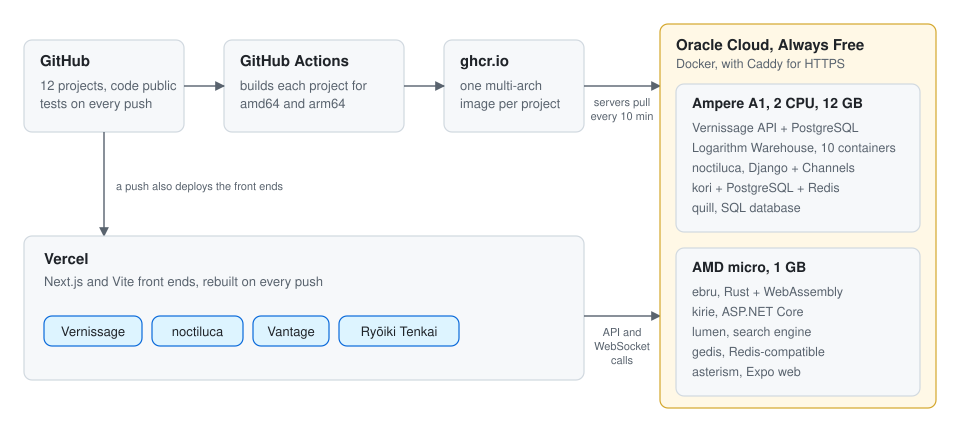

<!-- Generated by src/build.mjs from src/projects.mjs. Edit those, then run node build.mjs in src/. -->

# Md. Nafiz Ahmed

Full-stack engineer at EngineFinders (UK, remote), based in Khulna, Bangladesh.

I build backend systems from scratch (a SQL database, a Redis, a search engine, a ledger) and ship them live, with the 3D and real-time front ends that run on top.

**2nd runner-up**, BUET CSE Fest 2026 · **Champion**, KUET First Byte Datathon 2025 · B.Sc. in Computer Science and Engineering, KUET (2023 to now)

[CV](https://nafiz-ahmed-xi.vercel.app/resume.pdf) · [Portfolio](https://nafiz-ahmed-xi.vercel.app) · [LinkedIn](https://www.linkedin.com/in/nafiz-ahmed-770a3a273/) · [Email](mailto:nafizahmed000@gmail.com)

## Everything here runs live

<picture>
  <source media="(prefers-color-scheme: dark)" srcset="assets/architecture-dark.svg">
  
</picture>

GitHub Actions builds every project for amd64 and arm64 on each push, and the servers pull the new images within ten minutes. The setup is in [portfolio-deploy](https://github.com/Nafiz001/portfolio-deploy). Every link below was opened before this page was built.

## Selected work

### Vernissage

Hang your own exhibition of 8,263 public-domain works from The Met and the Cleveland Museum of Art, then walk through it in 3D with whoever opens the link. One Go binary serves the API, the WebSocket hub and the deep-zoom tiles.

Go, PostgreSQL, Next.js, React Three Fiber, WebSockets · [live](https://vernissage-pi.vercel.app) · [code](https://github.com/Nafiz001/vernissage)

### Databases and servers from scratch

| Project | What it is | Links |
|---|---|---|
| **quill** | A SQL database in Go: a B+tree on slotted pages, a write-ahead log with crash recovery, and the PostgreSQL wire protocol, so `psql` connects to the live read-only demo. Go | [live](https://quill.130-210-37-18.sslip.io) · [code](https://github.com/Nafiz001/quill) |
| **gedis** | A Redis-compatible store that speaks RESP, so the official `redis-cli` talks to it, with replication, AOF persistence and eviction. A public instance takes connections. Go | [live](https://gedis.130-210-16-198.sslip.io) · [code](https://github.com/Nafiz001/gedis) |
| **lumen** | A search engine with only Go's standard library: a crawler, an inverted index, BM25 ranking and snippets, live over the Go blog's 400 pages. Go | [live](https://lumen.130-210-16-198.sslip.io/?q=goroutines+channels) · [code](https://github.com/Nafiz001/lumen) |

### Distributed systems and payments

| Project | What it is | Links |
|---|---|---|
| **Logarithm Warehouse** | BUET CSE Fest 2026, 2nd runner-up. A fragile monolith rebuilt as Order and Inventory services with a database each, behind Nginx. A shared Redis counter keeps the chaos tests deterministic across three replicas; Prometheus and Grafana watch it. Node.js, PostgreSQL, Redis, Nginx, Prometheus, Grafana | [live](https://warehouse.130-210-37-18.sslip.io) · [code](https://github.com/Nafiz001/logarithm-warehouse) |
| **kori** | A double-entry ledger and payments API: balanced transactions, idempotent retries, and a check that re-derives every balance from the journal. Try to break it in the live sandbox. TypeScript, PostgreSQL, Redis | [live](https://kori.130-210-37-18.sslip.io) · [code](https://github.com/Nafiz001/kori) |

### Real-time and interactive

| Project | What it is | Links |
|---|---|---|
| **noctiluca** | A deep-sea dive lit by strangers' messages. A light's fade is an exponential the database indexes, and other divers appear live over WebSockets. Django, Channels, Next.js, WebGL | [live](https://noctiluca-two.vercel.app) · [code](https://github.com/Nafiz001/noctiluca) |
| **kirie** | A pop-up paper book of the sky over 36 places, lit by the weather there right now, with live readers folding paper cranes. ASP.NET Core, SignalR, SvelteKit, CSS 3D | [live](https://kirie.130-210-16-198.sslip.io) · [code](https://github.com/Nafiz001/kirie) |
| **ebru** | Turkish paper marbling that anyone can work in at once, with the same Rust maths on the server and in the browser, bit for bit. Rust, axum, WebAssembly, Vue | [live](https://ebru.130-210-16-198.sslip.io) · [code](https://github.com/Nafiz001/ebru) |
| **Vantage** | Techathon Nationals 2026. A 6-DOF robot arm driven by joystick, voice, hand gestures or an LLM agent, every command through one IK solver and safety gate. React Three Fiber, URDF, MediaPipe, Arduino firmware | [live](https://logarithm-techathon.vercel.app) · [code](https://github.com/Nafiz001/logarithm-techathon) |
| **Asterism** | A stargazing app: hold your phone to the sky and it names the stars, planets and the ISS. The link is its web build. Expo, React Native Skia, Reanimated | [live](https://asterism.130-210-16-198.sslip.io) · [code](https://github.com/Nafiz001/asterism) |
| **Ryōiki Tenkai** | Jujutsu Kaisen's Domain Expansions as a 2.5D depth tunnel, a clash simulator and a three.js realm, scored with the Web Audio API. TypeScript, Canvas 2D, three.js, Web Audio | [live](https://jjk-domain-expansion.vercel.app) · [code](https://github.com/Nafiz001/jjk-domain-expansion) |

More live work: [ShopCircuit](https://shopcircuit.vercel.app) ([code](https://github.com/Nafiz001/E-Commerce-)) · [DevEvent](https://dev-events-nextjs-six.vercel.app) ([code](https://github.com/Nafiz001/dev-events-nextjs)) · [Shabuj University Finder](https://shabuj-university-finder.vercel.app) ([code](https://github.com/Nafiz001/shabuj-university-finder)) · [Employee & Family Registry](https://employee-family-registry-system.vercel.app) ([code](https://github.com/Nafiz001/employee-family-registry-system)).

Open to remote full-time roles: [nafizahmed000@gmail.com](mailto:nafizahmed000@gmail.com).
