<!-- Generated by src/build.mjs from src/projects.mjs. Edit those, then run npm run build in src/. -->

<a href="https://nafiz-ahmed-xi.vercel.app"></a>

  &nbsp;
  &nbsp;
  &nbsp;
  

<a href="https://vernissage-pi.vercel.app">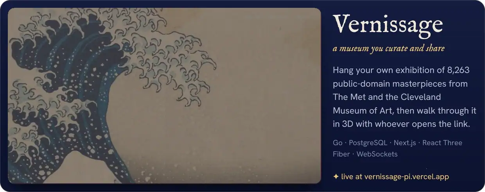</a>

  <a href="https://jjk-domain-expansion.vercel.app">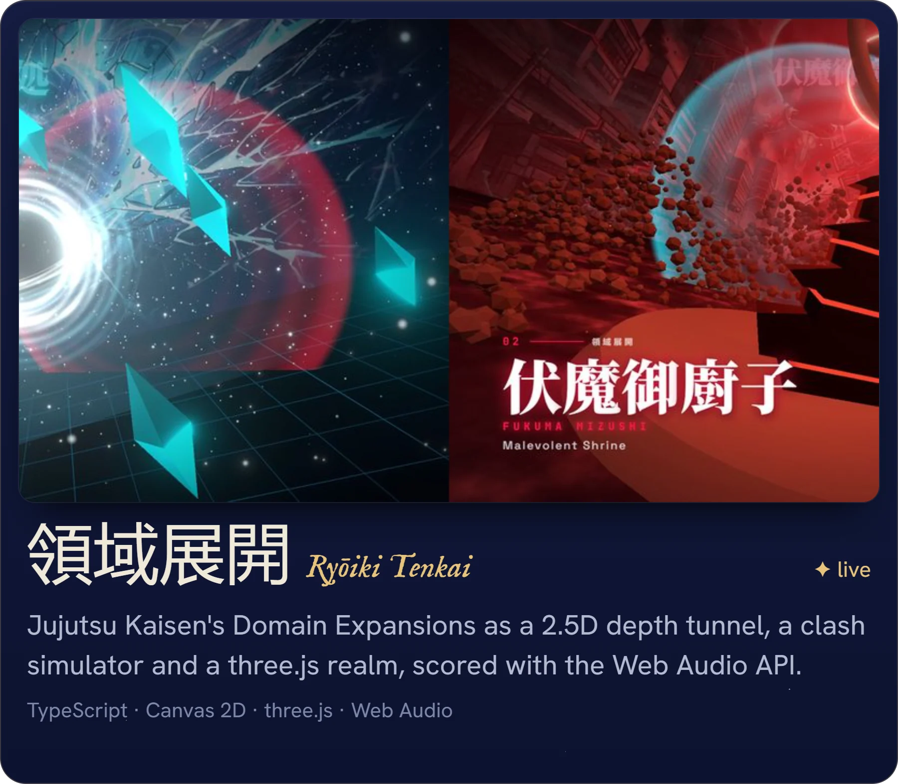</a>
  <a href="https://logarithm-techathon.vercel.app">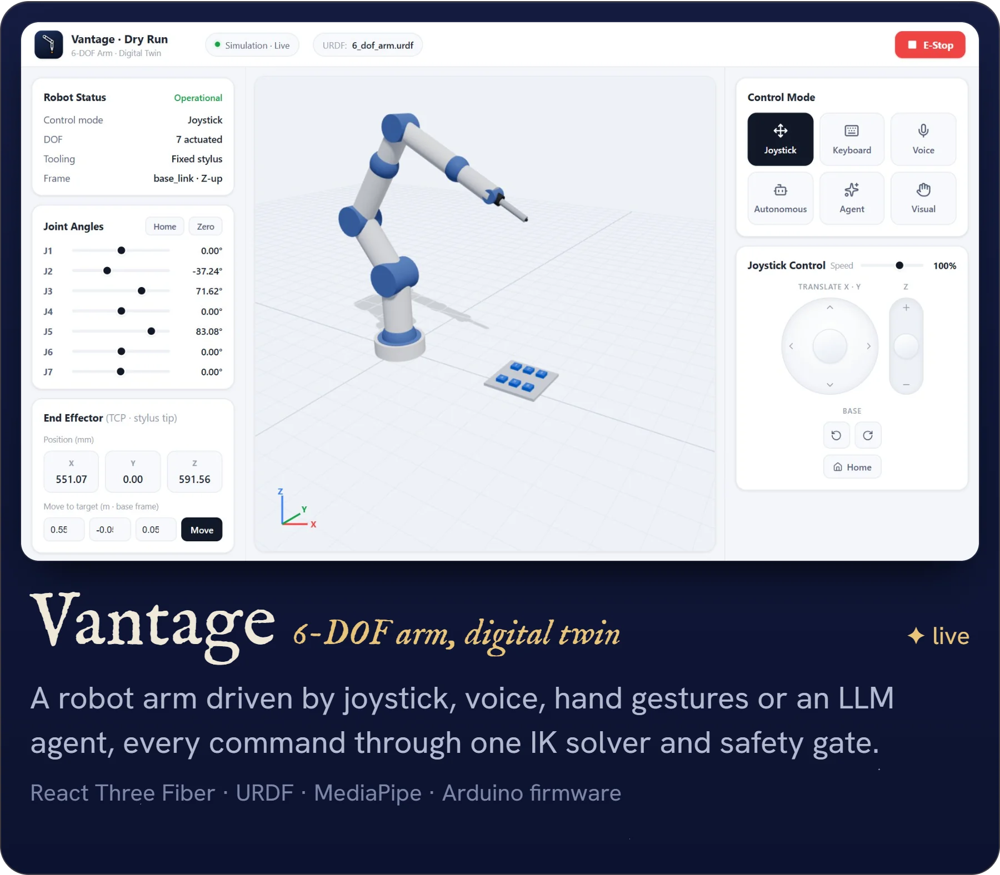</a>

  <a href="https://warehouse.130-210-37-18.sslip.io">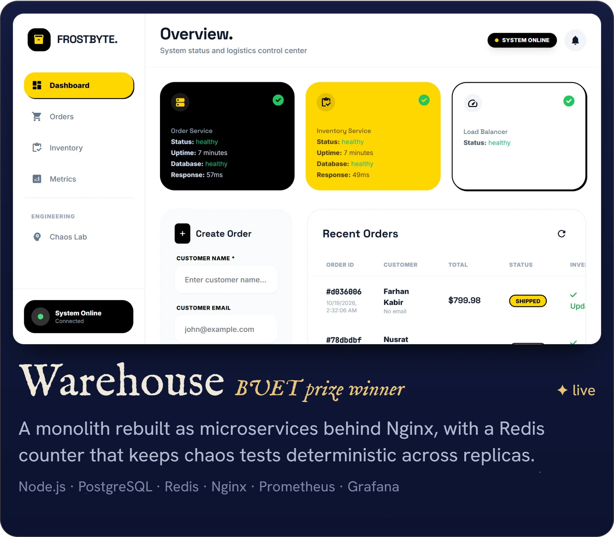</a>
  <a href="https://ebru.130-210-16-198.sslip.io">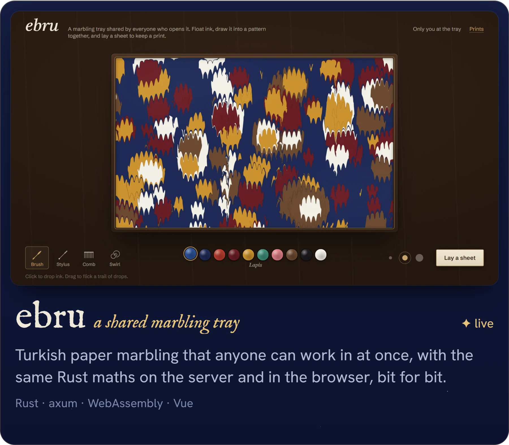</a>

  <a href="https://kirie.130-210-16-198.sslip.io">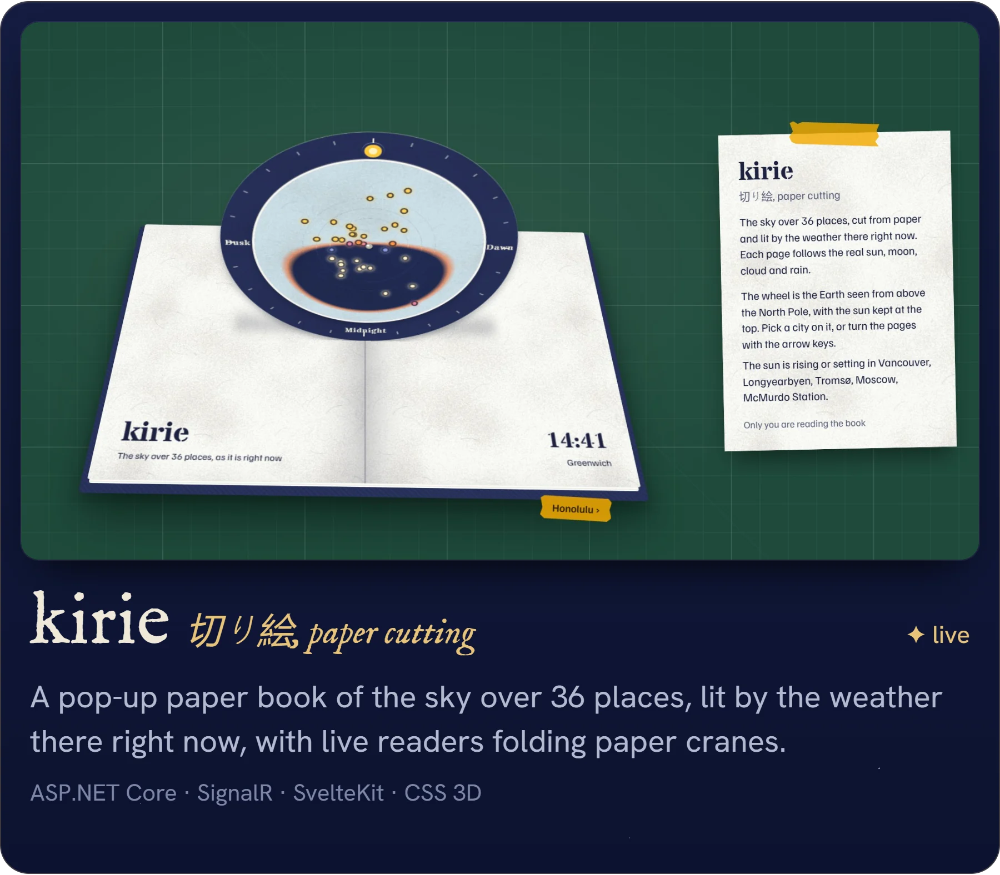</a>
  <a href="https://asterism.130-210-16-198.sslip.io">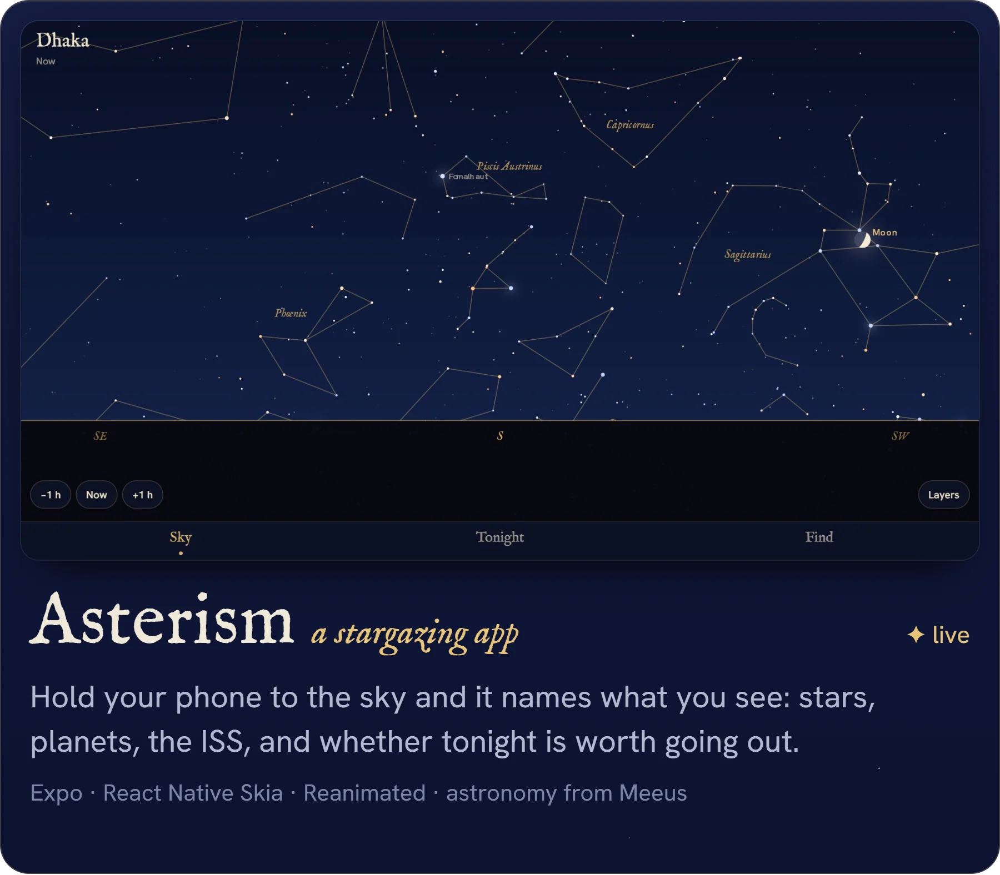</a>

  <a href="https://lumen.130-210-16-198.sslip.io/?q=goroutines+channels">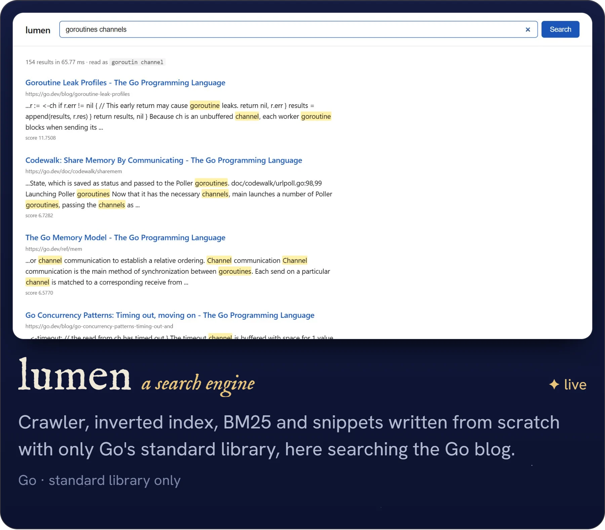</a>

<a href="https://gedis.130-210-16-198.sslip.io">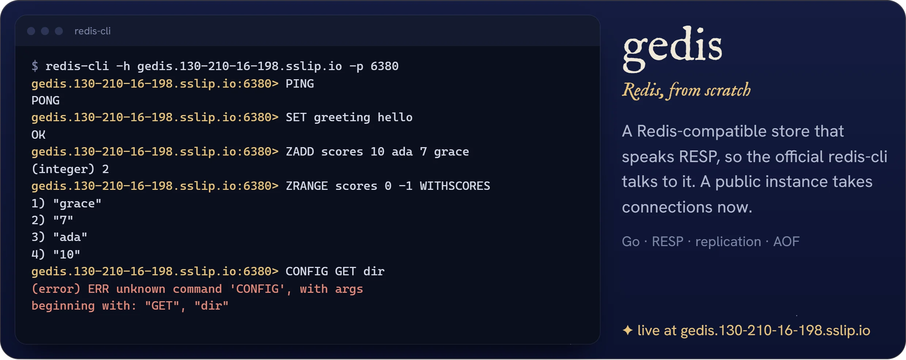</a>

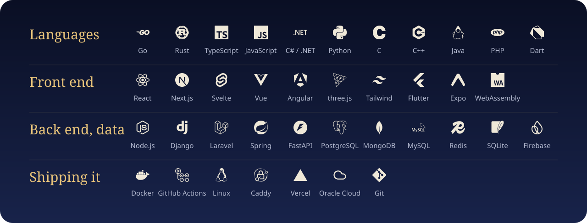

### Live, with source

| Project | Built with | Try it | Code |
|---|---|---|---|
| **Vernissage** · a museum you curate and share | Go · PostgreSQL · Next.js · React Three Fiber · WebSockets | [live](https://vernissage-pi.vercel.app) | [source](https://github.com/Nafiz001/vernissage) |
| **領域展開** · Ryōiki Tenkai | TypeScript · Canvas 2D · three.js · Web Audio | [live](https://jjk-domain-expansion.vercel.app) | [source](https://github.com/Nafiz001/jjk-domain-expansion) |
| **Vantage** · 6-DOF arm, digital twin | React Three Fiber · URDF · MediaPipe · Arduino firmware | [live](https://logarithm-techathon.vercel.app) | [source](https://github.com/Nafiz001/logarithm-techathon) |
| **Warehouse** · BUET prize winner | Node.js · PostgreSQL · Redis · Nginx · Prometheus · Grafana | [live](https://warehouse.130-210-37-18.sslip.io) | [source](https://github.com/Nafiz001/logarithm-warehouse) |
| **ebru** · a shared marbling tray | Rust · axum · WebAssembly · Vue | [live](https://ebru.130-210-16-198.sslip.io) | [source](https://github.com/Nafiz001/ebru) |
| **kirie** · 切り絵, paper cutting | ASP.NET Core · SignalR · SvelteKit · CSS 3D | [live](https://kirie.130-210-16-198.sslip.io) | [source](https://github.com/Nafiz001/kirie) |
| **Asterism** · a stargazing app | Expo · React Native Skia · Reanimated · astronomy from Meeus | [live](https://asterism.130-210-16-198.sslip.io) | [source](https://github.com/Nafiz001/asterism) |
| **lumen** · a search engine | Go · standard library only | [live](https://lumen.130-210-16-198.sslip.io/?q=goroutines+channels) | [source](https://github.com/Nafiz001/lumen) |
| **gedis** · Redis, from scratch | Go · RESP · replication · AOF | [live](https://gedis.130-210-16-198.sslip.io) | [source](https://github.com/Nafiz001/gedis) |

More live work: [ShopCircuit](https://shopcircuit.vercel.app) ([source](https://github.com/Nafiz001/E-Commerce-)) · [DevEvent](https://dev-events-nextjs-six.vercel.app) ([source](https://github.com/Nafiz001/dev-events-nextjs)) · [Shabuj University Finder](https://shabuj-university-finder.vercel.app) ([source](https://github.com/Nafiz001/shabuj-university-finder)) · [Employee & Family Registry](https://employee-family-registry-system.vercel.app) ([source](https://github.com/Nafiz001/employee-family-registry-system)).

The Go, Rust, .NET and Node projects run on two Oracle Cloud Always Free servers. GitHub Actions builds every project for amd64 and arm64 on each push, and the servers pull the new images within ten minutes: [portfolio-deploy](https://github.com/Nafiz001/portfolio-deploy). Every link above was opened in a browser before this page was built.

Open to full-time roles and freelance work: [nafizahmed000@gmail.com](mailto:nafizahmed000@gmail.com).
